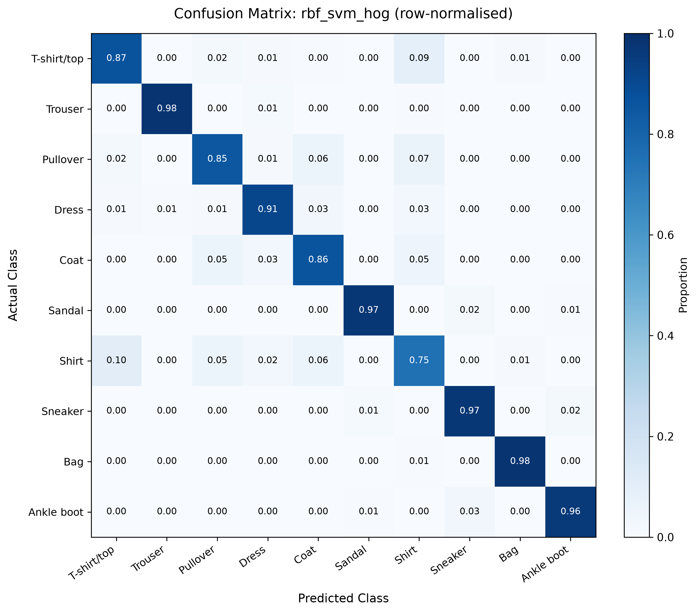

# Fashion-MNIST Classical ML Benchmark

A leak-free, reproducible benchmark of **classical machine learning** on [Fashion-MNIST](https://github.com/zalandoresearch/fashion-mnist)
(70,000 grayscale 28×28 clothing images, 10 classes). We compare Logistic Regression, k-NN, Random Forest, Linear SVM and
RBF SVM on two feature sets, **raw pixels** and **HOG** (Histogram of Oriented Gradients), measure accuracy, speed and model
size, and analyse which clothes get confused and why. This is **Capstone Phase 1**; the error analysis motivates the
Phase 2 CNN.

**Headline result:** the best model, chosen on the validation set, is an **RBF SVM on HOG features**:
**91.08% test accuracy** (validation 91.57%, 5-fold CV on a 10k subset 0.8775 ± 0.0054).
The hardest class is **Shirt**, which is mostly confused with T-shirt/top, Pullover and Coat.

## Contents
1. [Research questions](#1-research-questions)
2. [Dataset and fixed split](#2-dataset-and-fixed-split)
3. [Setup](#3-setup)
4. [Run the benchmark](#4-run-the-benchmark)
5. [Results](#5-results)
6. [Key findings](#6-key-findings)
7. [How we avoided data leakage](#7-how-we-avoided-data-leakage)
8. [Limitations](#8-limitations)
9. [Next: Capstone Phase 2 (CNN)](#9-next-capstone-phase-2-cnn)
10. [Repository layout and docs](#10-repository-layout-and-docs)
11. [Report and slides](#11-report-and-slides)
12. [Troubleshooting](#12-troubleshooting)
13. [Team](#13-team)

## 1. Research questions
| # | Question |
|---|---|
| RQ1 | How accurately can classical ML classify Fashion-MNIST from raw pixels? |
| RQ2 | Do HOG features beat raw pixels, and for which models? |
| RQ3 | Which model gives the best trade-off between accuracy, prediction speed and model size? |
| RQ4 | Which classes are confused most, and why do handcrafted features fail there? |

## 2. Dataset and fixed split
Classes: 0 T-shirt/top, 1 Trouser, 2 Pullover, 3 Dress, 4 Coat, 5 Sandal, 6 Shirt, 7 Sneaker, 8 Bag, 9 Ankle boot.

| Split | Images | Used for |
|---|---|---|
| Train | 54,000 | Fitting models while tuning |
| Validation | 6,000 (600 per class, stratified, seed 42) | **Every** choice: hyperparameters, HOG settings, best model |
| Test | 10,000 (official test set) | One final evaluation per experiment, nothing else |

The validation indices are committed in `data/splits/val_indices.npy`, so everyone gets exactly the same split. Check it:
```bash
md5 -q data/splits/val_indices.npy     # macOS (Linux/Colab: md5sum data/splits/val_indices.npy)
# expected: 54ff6b78b27109cdfc3ebe7204040a07
```

## 3. Setup
Python 3.12. Local VS Code is recommended; Google Colab works as a fallback.

```bash
git clone https://github.com/rajdeep-2004/fashion-image-classification-benchmark.git
cd fashion-image-classification-benchmark
conda create -n fmnist python=3.12 -y
conda activate fmnist
pip install -r requirements.txt        # pinned versions of numpy, pandas, scikit-learn, scikit-image, matplotlib, ipykernel
```
Without conda: `python3.12 -m venv .venv && source .venv/bin/activate && pip install -r requirements.txt`.

In VS Code, open a notebook and choose **Select Kernel → fmnist** (top right).

**Colab:** in the first cell run
```python
!git clone https://github.com/rajdeep-2004/fashion-image-classification-benchmark.git
%cd fashion-image-classification-benchmark
!pip install -q -r requirements.txt
```

**Download the data** (the 4 official files, each checked against Zalando's published MD5; ~5 min the first time):
```bash
python -c "from src.data import download_raw; download_raw()"
```
Files go to `data/raw/` (not committed). If a checksum fails, the bad file is deleted and you are told to run it again.

## 4. Run the benchmark
Open each notebook in `notebooks/` and run **Restart & Run All**, in order.

The repo already contains every tuning and test result (`results/metrics/*.json`). The notebooks **reuse** them instead of
re-tuning or re-testing, so the test set is never touched again and the results come out identical. Delete a result file
only if you really mean to redo that experiment.

| # | Notebook | What it does | ⏱ With committed results (measured, fresh clone, Apple M3) | ⏱ From scratch |
|---|---|---|---|---|
| 1 | `01_data_eda.ipynb` | Sanity checks, class balance, sample/mean images, PCA and t-SNE (train split only) | ~15 s | same |
| 2 | `02_features.ipynb` | Pixel and HOG features (cached in `features/`), sweep of 12 HOG settings | ~20 s | a few min |
| 3 | `03_linear_knn.ipynb` | Dummy, Logistic Regression, k-NN: tune on validation, one test run each | ~20 s | tens of minutes |
| 4 | `04_rf_svm.ipynb` | Random Forest, Linear SVM, RBF SVM (tuned on a 10k subset, refit on all 60k) | ~40 s | ~2 h |
| 5 | `05_results_analysis.ipynb` | Summary table, comparison plots, 5-fold CV, error analysis, answers to RQ1–RQ4 | ~10 s | ~2 min |

All five take under 2 minutes with the committed results, and every file in `results/` is regenerated byte-for-byte.

## 5. Results
All 12 experiments, generated from [`results/summary.csv`](results/summary.csv). Validation accuracy is the score used to
choose; test accuracy is reported only.

| Experiment | Model | Features | Val acc | Test acc | Macro F1 | Train time (s) | Inference (ms / 1,000 images) | Model size |
|---|---|---|---|---|---|---|---|---|
| `dummy_pixels` | Dummy (most frequent) | Pixels | 0.1000 | 0.1000 | 0.0182 | 0.00 | 0.00* | 709 B |
| `dummy_hog` | Dummy (most frequent) | HOG | 0.1000 | 0.1000 | 0.0182 | 0.16 | 0.01* | 709 B |
| `logreg_pixels` | Logistic Regression | Pixels | 0.8642 | 0.8472 | 0.8464 | n/a† | n/a† | 51.4 KB |
| `logreg_hog` | Logistic Regression | HOG | 0.8927 | 0.8886 | 0.8885 | n/a† | n/a† | 111.8 KB |
| `knn_pixels` | k-NN | Pixels | 0.8747 | 0.8611 | 0.8614 | 0.49 | 6,926.61 | 188.7 MB |
| `knn_hog` | k-NN | HOG | 0.8728 | 0.8631 | 0.8623 | 1.29 | 731.13 | 415.2 MB |
| `rf_pixels` | Random Forest | Pixels | 0.8867 | 0.8756 | 0.8741 | 32.83 | 12.16 | 366.5 MB |
| `rf_hog` | Random Forest | HOG | 0.8735 | 0.8703 | 0.8692 | 68.53 | 19.02 | 500.7 MB |
| `linear_svm_pixels` | Linear SVM | Pixels | 0.8583 | 0.8378 | 0.8353 | 99.24 | 1.22 | 82.7 KB |
| `linear_svm_hog` | Linear SVM | HOG | 0.8900 | 0.8898 | 0.8892 | 162.04 | 2.62 | 180.8 KB |
| `rbf_svm_pixels` | RBF SVM | Pixels | 0.9082 | 0.8970 | 0.8967 | 195.67 | 4,766.94 | 125.1 MB |
| `rbf_svm_hog` | RBF SVM | HOG | **0.9157** | **0.9108** | 0.9108 | 451.43 | 28,876.96‡ | 366.2 MB |

- **Val acc** comes from a model trained on all 54k training images. RBF SVM was tuned on a 10k subset, so its chosen
  settings were refit on 54k to get a comparable score (D-029).
- **Train time** is the final fit on all 60,000 train + validation images. **Inference** is model-only prediction time
  (best of 3). HOG models also need HOG extraction: about **216 ms per 1,000 images** (`results/hog_sweep.csv`).
- **Model size** is the pickled model (1 KB = 1,000 bytes).
- † Logistic Regression timings are not comparable (their runs overlapped other work, D-024); their accuracy is valid.
- \* Dummy timings are ~0 ms and were measured on a different machine.
- ‡ RBF SVM HOG compares each image with all 26,343 support vectors; the 28.9 s also looks ~2× slower than expected, so
  treat it as an upper bound (D-028).
- Timings come from two laptops: k-NN on an Apple M3, Random Forest and SVMs on an Apple M3 Pro. Gaps of 10× or more are
  clear; small gaps are approximate.

| Pixels vs HOG (RQ2) | Accuracy vs speed (RQ3) |
|---|---|
|  |  |

| Per-class recall (RQ4) | Confusion matrix of the best model |
|---|---|
|  |  |

All 32 figures are in [`results/figures/`](results/figures/), each produced by a notebook.

## 6. Key findings
**RQ1: raw pixels.** The best pixel model is the RBF SVM at **89.70%**. Random Forest reaches 87.56%, k-NN 86.11%
(k = 3, Manhattan distance), and the linear models only 83.78–84.72%: one pixel only says how bright one spot is, so a
straight boundary can't capture shape.

**RQ2: HOG vs pixels.** HOG helps the linear models most: **+5.20 points** for Linear SVM (83.78 → 88.98%) and **+4.14**
for Logistic Regression (84.72 → 88.86%). It lifts the RBF SVM to **91.08%** (+1.38). It does not help Random Forest
(−0.53) or k-NN (+0.20). A plausible reason: a tree split looks at one feature at a time, and one raw pixel says more on its
own than one HOG value.

**RQ3: speed vs accuracy vs size.** Counting HOG extraction, per 1,000 images:
| Need | Model | Test acc | End-to-end time | Size |
|---|---|---|---|---|
| Fastest above 87% | Random Forest, pixels | 87.56% | ~12 ms | 366 MB |
| Best accuracy for its size | Linear SVM, HOG | 88.98% | ~219 ms (mostly HOG) | 181 KB |
| Most accurate | RBF SVM, HOG | 91.08% | ~29 s (upper bound) | 366 MB |

k-NN is slower than Random Forest and less accurate, so it is never the best choice here.

**RQ4: what gets confused.** Shirt is the hardest class for all 10 trained models (recall 50.9% to 75.2%). The best model's
top confusions are Shirt → T-shirt/top (104 of 1,000 shirts), T-shirt/top → Shirt (91), Pullover → Shirt (66),
Pullover → Coat (61) and Shirt → Coat (59). Mistakes among T-shirt, Pullover, Coat and Shirt are 56–66% of every model's
errors. At 28×28 grayscale, collars, buttons and cuffs cover only a few pixels and these garments have very similar outlines.
The two RBF SVMs (HOG and pixels) both get 515 test images wrong, 391 of them with the *same* wrong label, which suggests
many of these images are ambiguous in the data itself.

## 7. How we avoided data leakage
- **Test set used once per experiment**, only inside `src.experiment.final_test_run()`. Every use is appended to
  [`results/test_log.csv`](results/test_log.csv): it has exactly 12 rows, one per experiment.
- **Every choice is made on validation**: hyperparameters, HOG settings and the best model (never by test score).
- **Scaling lives inside scikit-learn Pipelines**, so the scaler only ever learns from training rows, also inside CV folds.
- **EDA uses the training split only.**
- **Error analysis reads saved predictions**; no model predicts on test again.
- Seed (42), split file and tuning grids are fixed; any change needs a logged decision.

Every design choice and its reasoning is logged in [`docs/decisions.md`](docs/decisions.md) (D-001 to D-032).

## 8. Limitations
- **Grid edges:** the best C sits at the edge of the values tried for Logistic Regression and Linear SVM (0.01, smallest) and
  RBF SVM (10, largest). Grids were not widened afterwards, to avoid another test run.
- **Validation is slightly optimistic:** val accuracy is above test for all 10 trained models (by 0.02–2.05 points),
  because each model's settings were picked as the best on val. Val also has about ±0.4 points of sampling noise.
- **CV is a stability check, not a final score:** 0.8775 ± 0.0054 on a 10k subset (each fold trains
  on 8,000 images), lower than the full-data scores.
- **Timings** come from two machines and two Logistic Regression timings are excluded (see Results).

## 9. Next: Capstone Phase 2 (CNN)
Phase 2 will train a small convolutional network on the **same split** and score it with the **same `evaluate()`**, so it
drops straight into this table. Our hypothesis: learned filters can pick up the small details (collars, buttons, cuffs) that
fixed HOG features miss, beating 91.08% mainly by fixing the Shirt / T-shirt / Pullover / Coat confusions (397 of the 515
images both RBF SVMs get wrong are in these classes).

## 10. Repository layout and docs
```
fashion-image-classification-benchmark/
├── README.md                    this file
├── requirements.txt             pinned Python dependencies
├── AGENTS.md                    rules for every contributor and AI tool (including the no-leakage rules)
├── CONTRIBUTING.md              step-by-step contributor workflow and troubleshooting
├── CLAUDE.md                    project notes for Claude Code
├── idea.md                      early brainstorming (superseded by docs/)
├── .github/
│   └── pull_request_template.md
├── src/                         reusable pipeline code (notebooks only call these)
│   ├── config.py                seed, sizes, class names, paths, HOG settings, n_jobs
│   ├── utils.py                 seeding, timing, save_fig, JSON helpers
│   ├── data.py                  download, checksum check, loading, fixed train/val split
│   ├── features.py              raw-pixel and HOG features, cached in features/
│   ├── models_linear.py         Dummy, Logistic Regression, kNN pipelines + tuning grids
│   ├── models_tree_kernel.py    Random Forest, LinearSVC, RBF SVM pipelines + tuning grids
│   ├── evaluate.py              shared metrics, timing and model-size measurement
│   ├── experiment.py            tune on val; final_test_run() is the only place test data is used
│   └── results.py               summary table, comparison plots, error analysis
├── notebooks/                   one per stage, committed with outputs; run in order
│   ├── 01_data_eda.ipynb
│   ├── 02_features.ipynb
│   ├── 03_linear_knn.ipynb
│   ├── 04_rf_svm.ipynb
│   └── 05_results_analysis.ipynb
├── data/
│   ├── splits/val_indices.npy   the fixed validation split (committed)
│   └── raw/                     downloaded dataset (not committed)
├── features/                    cached feature arrays (not committed, rebuilt by code)
├── results/                     everything here is written by code
│   ├── metrics/                 27 JSONs: <model>_<features>_val/test.json, plus RBF SVM CV and full-train val
│   ├── figures/                 32 PNGs: eda_*, features_*, linear_*, treekernel_*, results_*, errors_*
│   ├── summary.csv              one row per experiment (12 rows)
│   ├── test_log.csv             audit trail: one row per test evaluation
│   └── hog_sweep.csv            HOG settings tried on val
├── report/                      IEEE report (LaTeX + PDF), slides (PDF + source), team walkthrough
└── docs/
    ├── README.md                index of the docs
    ├── prd.md                   goals, scope, research questions, sanity ranges
    ├── architecture.md          components and folder layout
    ├── system-design.md         pipeline flow and leakage rules
    ├── data-formats.md          format of every saved file
    ├── module-interfaces.md     signature of every src/ function
    ├── decisions.md             every decision and why
    ├── progress.md              phase status and session log
    └── phases/
        ├── _phase-template.md
        └── v1/                  phase-01 … phase-05 task files
```
| Want to know… | Read |
|---|---|
| What we built and why | [`docs/prd.md`](docs/prd.md) |
| How the code is organised | [`docs/architecture.md`](docs/architecture.md) |
| How the pipeline runs and stays leak-free | [`docs/system-design.md`](docs/system-design.md) |
| What each saved file contains | [`docs/data-formats.md`](docs/data-formats.md) |
| What each `src/` function takes and returns | [`docs/module-interfaces.md`](docs/module-interfaces.md) |
| Why each choice was made | [`docs/decisions.md`](docs/decisions.md) |

## 11. Report and slides
[`report/`](report/) holds the project report and presentation:
- `report.pdf` / `report.tex`: the IEEE-style report and its LaTeX source
- `ppt.pdf` / `ppt.md`: the presentation slides and their source text
- `presentation.md`: team walkthrough of the project for the viva

## 12. Troubleshooting
| Problem | Fix |
|---|---|
| `ModuleNotFoundError: No module named 'src'` | Run notebooks from the repo (the first cell adds the repo root to the path) |
| Notebook can't find the `fmnist` kernel | `conda activate fmnist && pip install -r requirements.txt`, then reload VS Code |
| `Checksum mismatch` on download | The file was deleted; run `download_raw()` again |
| Kernel dies / out of memory | Close other apps; lower `N_JOBS` in `src/config.py` if needed (8 GB RAM is enough) |
| `WARNING: … evaluated on test 2 times` | A test evaluation was re-run; explain why in `docs/decisions.md` |

## 13. Team
| # | Name | Enrollment No. | Work done |
|---|---|---|---|
| 1 | Tanmay Singh | 2401010476 | **Data pipeline & EDA:** dataset download and checksum checks, data sanity checks, fixed train/val/test split, exploratory analysis |
| 2 | Anand Mishra | 2401010065 | **Feature engineering & evaluation framework:** pixel and HOG features, HOG settings sweep, shared tuning, testing and evaluation code |
| 3 | Rajdeep Sanyal | 2401010370 | **Linear & distance-based models:** Dummy baseline, Logistic Regression, k-Nearest Neighbours (tuning, testing, analysis) |
| 4 | Rajat Srivastav | 2401020101 | **Tree & kernel models:** Random Forest, Linear SVM, RBF SVM (tuning, testing, analysis) |
| 5 | Omved Nagre | 2401010311 | **Results, error analysis & documentation:** summary table, comparison plots, cross-validation, error analysis, final write-up and README |
