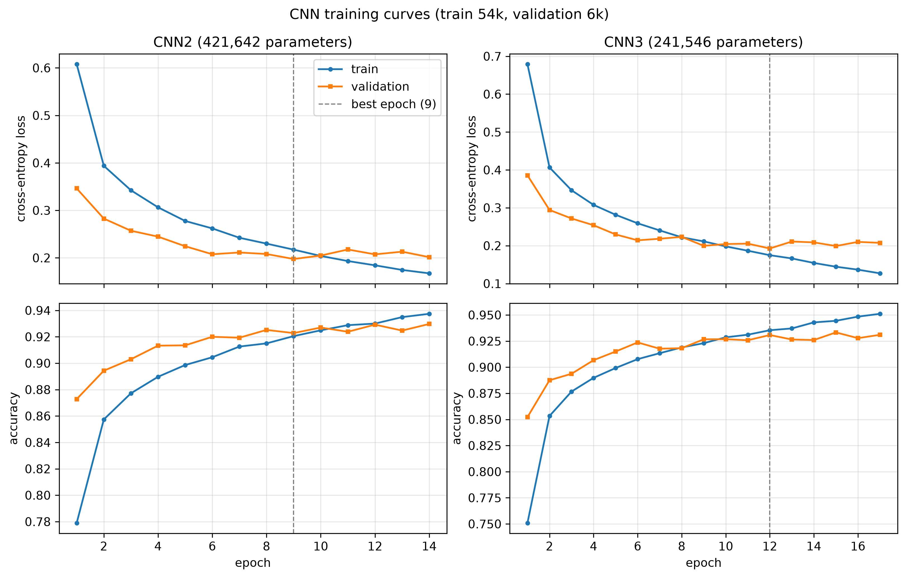
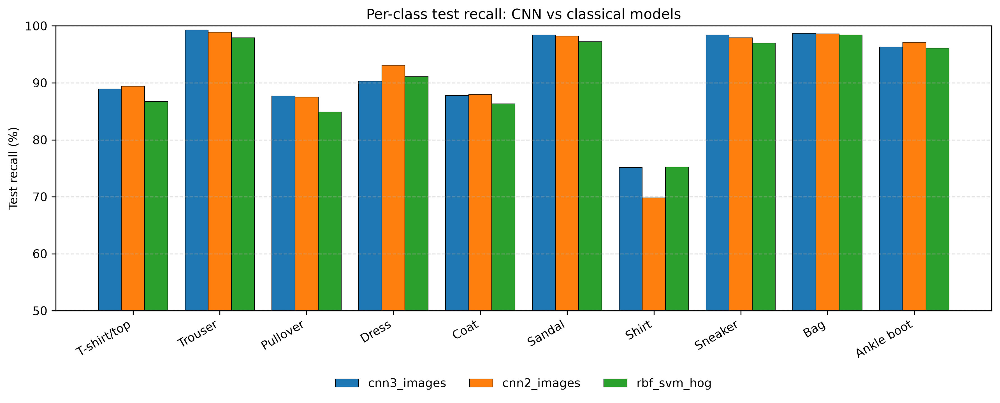
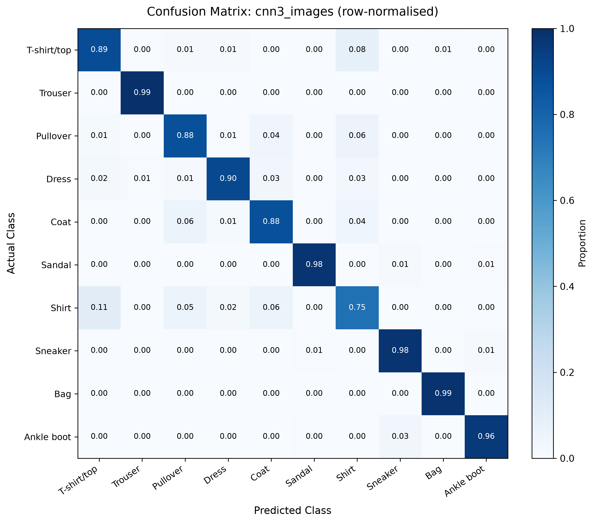
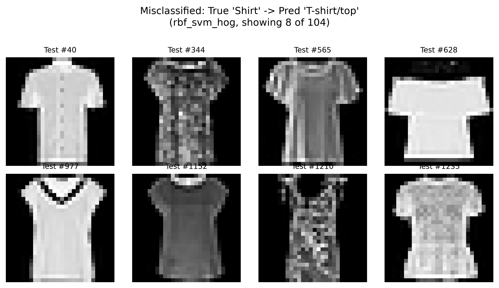
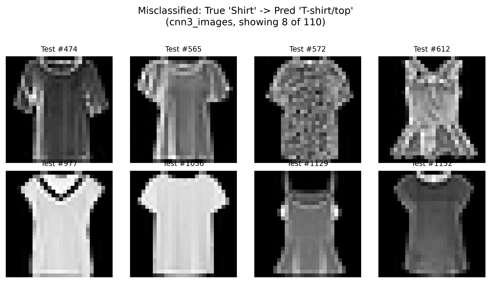

# Fashion-MNIST: Classical ML vs a Small CNN

A leak-free, reproducible comparison of **handcrafted features** and **learned features** on
[Fashion-MNIST](https://github.com/zalandoresearch/fashion-mnist) (70,000 grayscale 28×28 clothing images, 10 classes).

- **Phase 1 (classical ML, release `v1.0.0`):** Logistic Regression, k-NN, Random Forest, Linear SVM and RBF SVM on two
  feature sets, **raw pixels** and **HOG** (Histogram of Oriented Gradients), with accuracy, speed, size and error analysis.
- **Phase 2 (deep learning):** two small **convolutional neural networks** (2 and 3 conv blocks, with pooling, dropout and
  early stopping) trained on the **same split** and scored by the **same evaluation code**, then compared image by image
  with the best classical model.

**Headline results** (10,000-image official test set, each model evaluated once):

| | Model | Test accuracy (95% CI) | Macro F1 | Shirt recall | ms per 1,000 images | Size |
|---|---|---|---|---|---|---|
| Best classical | RBF SVM on HOG | 91.08% (90.51–91.62) | 0.9108 | 75.2% | ~29,000 | 366 MB |
| **Best CNN** | **CNN3** (3 conv blocks) | **92.09% (91.54–92.60)** | **0.9208** | 75.1% | **94** | **0.97 MB** |

The CNN makes 101 fewer mistakes (significant, McNemar p = 2.2 × 10⁻⁴) and is ~300× faster and ~377× smaller, but it
does **not** fix the hardest class: Shirt is still confused with T-shirt/top, Pullover and Coat, and most of the remaining
errors are shared with the SVM, which points to genuinely ambiguous images.

## Contents
1. [Research questions](#1-research-questions)
2. [Dataset and fixed split](#2-dataset-and-fixed-split)
3. [Setup](#3-setup)
4. [Run the benchmark](#4-run-the-benchmark)
5. [Results (Phase 1)](#5-results-phase-1)
6. [Key findings (Phase 1)](#6-key-findings-phase-1)
7. [How we avoided data leakage](#7-how-we-avoided-data-leakage)
8. [Limitations (Phase 1)](#8-limitations-phase-1)
9. [Phase 2: CNN vs classical models](#9-phase-2-cnn-vs-classical-models)
10. [Repository layout and docs](#10-repository-layout-and-docs)
11. [Report and slides](#11-report-and-slides)
12. [Troubleshooting](#12-troubleshooting)
13. [Team](#13-team)

## 1. Research questions
| # | Question |
|---|---|
| RQ1 | How accurately can classical ML classify Fashion-MNIST from raw pixels? |
| RQ2 | Do HOG features beat raw pixels, and for which models? |
| RQ3 | Which model gives the best trade-off between accuracy, prediction speed and model size? |
| RQ4 | Which classes are confused most, and why do handcrafted features fail there? |
| RQ5 | Does a small CNN beat the best classical model on accuracy and macro F1? |
| RQ6 | Does the CNN reduce the Shirt / T-shirt / Pullover / Coat confusion? |
| RQ7 | Does a third convolutional block help? |
| RQ8 | What does the CNN cost (parameters, size, inference time)? |

RQ1–RQ4 are Phase 1 (sections 5–8), RQ5–RQ8 are Phase 2 (section 9).

## 2. Dataset and fixed split
Classes: 0 T-shirt/top, 1 Trouser, 2 Pullover, 3 Dress, 4 Coat, 5 Sandal, 6 Shirt, 7 Sneaker, 8 Bag, 9 Ankle boot.

| Split | Images | Used for |
|---|---|---|
| Train | 54,000 | Fitting models while tuning; the CNNs' only training data |
| Validation | 6,000 (600 per class, stratified, seed 42) | **Every** choice: hyperparameters, HOG settings, best model, CNN early stopping and CNN choice |
| Test | 10,000 (official test set) | One final evaluation per experiment, nothing else |

The validation indices are committed in `data/splits/val_indices.npy`, so everyone gets exactly the same split. Check it:
```bash
md5 -q data/splits/val_indices.npy     # macOS (Linux/Colab: md5sum data/splits/val_indices.npy)
# expected: 54ff6b78b27109cdfc3ebe7204040a07
```

## 3. Setup
Python 3.12. Local VS Code is recommended; Google Colab works as a fallback.

```bash
git clone https://github.com/rajdeep-2004/fashion-image-classification-benchmark.git
cd fashion-image-classification-benchmark
conda create -n fmnist python=3.12 -y
conda activate fmnist
pip install -r requirements.txt        # pinned numpy, pandas, scikit-learn, scikit-image, matplotlib, ipykernel, torch (CPU)
```
Without conda: `python3.12 -m venv .venv && source .venv/bin/activate && pip install -r requirements.txt`.

In VS Code, open a notebook and choose **Select Kernel → fmnist** (top right).

**Colab:** in the first cell run
```python
!git clone https://github.com/rajdeep-2004/fashion-image-classification-benchmark.git
%cd fashion-image-classification-benchmark
!pip install -q -r requirements.txt
```

**Download the data** (the 4 official files, each checked against Zalando's published MD5; ~5 min the first time):
```bash
python -c "from src.data import download_raw; download_raw()"
```
Files go to `data/raw/` (not committed). If a checksum fails, the bad file is deleted and you are told to run it again.

## 4. Run the benchmark
Open each notebook in `notebooks/` and run **Restart & Run All**, in order.

The repo already contains every tuning and test result (`results/metrics/*.json`). The notebooks **reuse** them instead of
re-tuning or re-testing, so the test set is never touched again and the results come out identical. Delete a result file
only if you really mean to redo that experiment.

| # | Notebook | What it does | ⏱ With committed results (measured, fresh clone, Apple M3) | ⏱ From scratch |
|---|---|---|---|---|
| 1 | `01_data_eda.ipynb` | Sanity checks, class balance, sample/mean images, PCA and t-SNE (train split only) | ~15 s | same |
| 2 | `02_features.ipynb` | Pixel and HOG features (cached in `features/`), sweep of 12 HOG settings | ~20 s | a few min |
| 3 | `03_linear_knn.ipynb` | Dummy, Logistic Regression, k-NN: tune on validation, one test run each | ~20 s | tens of minutes |
| 4 | `04_rf_svm.ipynb` | Random Forest, Linear SVM, RBF SVM (tuned on a 10k subset, refit on all 60k) | ~40 s | ~2 h |
| 5 | `05_results_analysis.ipynb` | Summary table, comparison plots, 5-fold CV, error analysis, answers to RQ1–RQ4 | ~10 s | ~2 min |
| 6 | `06_cnn_training.ipynb` | CNN2 and CNN3: shapes, parameter counts, training with early stopping, choice on validation, one test run each | ~10 s | ~11 min (CPU) |
| 7 | `07_cnn_vs_classical.ipynb` | CNN vs RBF SVM: metrics, per-class recall, confusion matrices, example errors, agreement, answers to RQ5–RQ8 | ~10 s | same |

All seven take about 2 minutes with the committed results (measured on a fresh clone, Apple M3), and every file in
`results/` is regenerated byte-for-byte except `eda_tsne.png`: t-SNE runs in parallel threads, and with PyTorch's OpenMP
runtime installed a few points move slightly; the picture and its conclusions are the same (D-043).
Notebook 06 skips training when a CNN's `_val.json` exists. CNN weights (`models/`) are not committed; to rebuild them,
delete `results/metrics/cnn{2,3}_images_val.json` and re-run notebook 06: training is seeded and deterministic on CPU,
so it reproduces the same numbers.

## 5. Results (Phase 1)
All 12 classical experiments, generated from [`results/summary.csv`](results/summary.csv). Validation accuracy is the score used to
choose; test accuracy is reported only.

| Experiment | Model | Features | Val acc | Test acc | Macro F1 | Train time (s) | Inference (ms / 1,000 images) | Model size |
|---|---|---|---|---|---|---|---|---|
| `dummy_pixels` | Dummy (most frequent) | Pixels | 0.1000 | 0.1000 | 0.0182 | 0.00 | 0.00* | 709 B |
| `dummy_hog` | Dummy (most frequent) | HOG | 0.1000 | 0.1000 | 0.0182 | 0.16 | 0.01* | 709 B |
| `logreg_pixels` | Logistic Regression | Pixels | 0.8642 | 0.8472 | 0.8464 | n/a† | n/a† | 51.4 KB |
| `logreg_hog` | Logistic Regression | HOG | 0.8927 | 0.8886 | 0.8885 | n/a† | n/a† | 111.8 KB |
| `knn_pixels` | k-NN | Pixels | 0.8747 | 0.8611 | 0.8614 | 0.49 | 6,926.61 | 188.7 MB |
| `knn_hog` | k-NN | HOG | 0.8728 | 0.8631 | 0.8623 | 1.29 | 731.13 | 415.2 MB |
| `rf_pixels` | Random Forest | Pixels | 0.8867 | 0.8756 | 0.8741 | 32.83 | 12.16 | 366.5 MB |
| `rf_hog` | Random Forest | HOG | 0.8735 | 0.8703 | 0.8692 | 68.53 | 19.02 | 500.7 MB |
| `linear_svm_pixels` | Linear SVM | Pixels | 0.8583 | 0.8378 | 0.8353 | 99.24 | 1.22 | 82.7 KB |
| `linear_svm_hog` | Linear SVM | HOG | 0.8900 | 0.8898 | 0.8892 | 162.04 | 2.62 | 180.8 KB |
| `rbf_svm_pixels` | RBF SVM | Pixels | 0.9082 | 0.8970 | 0.8967 | 195.67 | 4,766.94 | 125.1 MB |
| `rbf_svm_hog` | RBF SVM | HOG | **0.9157** | **0.9108** | 0.9108 | 451.43 | 28,876.96‡ | 366.2 MB |

- **Val acc** comes from a model trained on all 54k training images. RBF SVM was tuned on a 10k subset, so its chosen
  settings were refit on 54k to get a comparable score (D-029).
- **Train time** is the final fit on all 60,000 train + validation images. **Inference** is model-only prediction time
  (best of 3). HOG models also need HOG extraction: about **216 ms per 1,000 images** (`results/hog_sweep.csv`).
- **Model size** is the pickled model (1 KB = 1,000 bytes).
- † Logistic Regression timings are not comparable (their runs overlapped other work, D-024); their accuracy is valid.
- \* Dummy timings are ~0 ms and were measured on a different machine.
- ‡ RBF SVM HOG compares each image with all 26,343 support vectors; the 28.9 s also looks ~2× slower than expected, so
  treat it as an upper bound (D-028).
- Timings come from two laptops: k-NN on an Apple M3, Random Forest and SVMs on an Apple M3 Pro. Gaps of 10× or more are
  clear; small gaps are approximate.

| Pixels vs HOG (RQ2) | Accuracy vs speed (RQ3) |
|---|---|
|  |  |

| Per-class recall (RQ4) | Confusion matrix of the best model |
|---|---|
|  |  |

All 32 figures are in [`results/figures/`](results/figures/), each produced by a notebook.

## 6. Key findings (Phase 1)
**RQ1: raw pixels.** The best pixel model is the RBF SVM at **89.70%**. Random Forest reaches 87.56%, k-NN 86.11%
(k = 3, Manhattan distance), and the linear models only 83.78–84.72%: one pixel only says how bright one spot is, so a
straight boundary can't capture shape.

**RQ2: HOG vs pixels.** HOG helps the linear models most: **+5.20 points** for Linear SVM (83.78 → 88.98%) and **+4.14**
for Logistic Regression (84.72 → 88.86%). It lifts the RBF SVM to **91.08%** (+1.38). It does not help Random Forest
(−0.53) or k-NN (+0.20). A plausible reason: a tree split looks at one feature at a time, and one raw pixel says more on its
own than one HOG value.

**RQ3: speed vs accuracy vs size.** Counting HOG extraction, per 1,000 images:
| Need | Model | Test acc | End-to-end time | Size |
|---|---|---|---|---|
| Fastest above 87% | Random Forest, pixels | 87.56% | ~12 ms | 366 MB |
| Best accuracy for its size | Linear SVM, HOG | 88.98% | ~219 ms (mostly HOG) | 181 KB |
| Most accurate | RBF SVM, HOG | 91.08% | ~29 s (upper bound) | 366 MB |

k-NN is slower than Random Forest and less accurate, so it is never the best choice here.

**RQ4: what gets confused.** Shirt is the hardest class for all 10 trained models (recall 50.9% to 75.2%). The best model's
top confusions are Shirt → T-shirt/top (104 of 1,000 shirts), T-shirt/top → Shirt (91), Pullover → Shirt (66),
Pullover → Coat (61) and Shirt → Coat (59). Mistakes among T-shirt, Pullover, Coat and Shirt are 56–66% of every model's
errors. At 28×28 grayscale, collars, buttons and cuffs cover only a few pixels and these garments have very similar outlines.
The two RBF SVMs (HOG and pixels) both get 515 test images wrong, 391 of them with the *same* wrong label, which suggests
many of these images are ambiguous in the data itself.

## 7. How we avoided data leakage
- **Test set used once per experiment**, only inside `src.experiment.final_test_run()` (Phase 1) and
  `final_test_run_cnn()` (Phase 2). Every use is appended to [`results/test_log.csv`](results/test_log.csv): it has
  exactly 14 rows, one per experiment.
- **Every choice is made on validation**: hyperparameters, HOG settings and the best model (never by test score).
- **Scaling lives inside scikit-learn Pipelines**, so the scaler only ever learns from training rows, also inside CV folds.
- **EDA uses the training split only.**
- **Error analysis reads saved predictions**; no model predicts on test again.
- Seed (42), split file and tuning grids are fixed; any change needs a logged decision.
- **CNNs train on the 54k train split only.** Validation decides when to stop (early stopping) and which CNN is final;
  it never updates weights. There is no test DataLoader.
- **Scoring always runs with dropout off** (`model.eval()` and `torch.no_grad()`).
- **Phase 2 never rewrites Phase 1 outputs:** `summary.csv` keeps its 12 rows; all 14 models are in `summary_all.csv`.

Every design choice and its reasoning is logged in [`docs/decisions.md`](docs/decisions.md) (D-001 to D-043).

## 8. Limitations (Phase 1)
- **Grid edges:** the best C sits at the edge of the values tried for Logistic Regression and Linear SVM (0.01, smallest) and
  RBF SVM (10, largest). Grids were not widened afterwards, to avoid another test run.
- **Validation is slightly optimistic:** val accuracy is above test for all 10 trained models (by 0.02–2.05 points),
  because each model's settings were picked as the best on val. Val also has about ±0.4 points of sampling noise.
- **CV is a stability check, not a final score:** 0.8775 ± 0.0054 on a 10k subset (each fold trains
  on 8,000 images), lower than the full-data scores.
- **Timings** come from two machines and two Logistic Regression timings are excluded (see Results).

## 9. Phase 2: CNN vs classical models
Phase 1 ended with a hypothesis: learned filters can pick up the small details (collars, buttons, cuffs) that fixed HOG
features miss, beating 91.08% mainly by fixing the Shirt / T-shirt / Pullover / Coat confusions. Phase 2 tests it.

**Models.** Each conv block is a 3×3 convolution (padding 1) + ReLU + 2×2 max pooling.
| Model | Layers | Parameters |
|---|---|---|
| CNN2 | 2 conv blocks (32, 64 filters) → 3,136 → dense 128 → dropout 0.5 → 10 | 421,642 |
| CNN3 | 3 conv blocks (32, 64, 128 filters) → 1,152 → dense 128 → dropout 0.5 → 10 | 241,546 |

CNN3 is deeper but **smaller**: its extra pooling shrinks what feeds the big dense layer.

**Training.** Adam (learning rate 0.001), cross-entropy, batch 64, up to 30 epochs, **early stopping** on validation loss
(patience 5, best weights restored). CPU only, seed 42, deterministic: re-running gives identical numbers.
CNNs learn from 54k images, while the Phase 1 models were refit on 60k, because early stopping needs the validation set.
This can only disadvantage the CNN.

**Model choice (validation only).** CNN2 0.9228, CNN3 **0.9308** → final CNN = CNN3. Both beat every classical model on
validation (best: RBF SVM on HOG, 0.9157).



**Test results** (from [`results/summary_all.csv`](results/summary_all.csv); one test run per CNN, after the choice):
| Experiment | Val acc | Test acc (95% CI) | Macro F1 | Errors / 10,000 | Train time (s) | Inference (ms / 1,000) | Size |
|---|---|---|---|---|---|---|---|
| `cnn3_images` (final) | **0.9308** | **0.9209** (91.54–92.60) | **0.9208** | 791 | 416 | 94.4 | 0.97 MB (241,546 params) |
| `cnn2_images` | 0.9228 | 0.9185 (91.30–92.37) | 0.9176 | 815 | 198 | 58.4 | 1.69 MB (421,642 params) |
| `rbf_svm_hog` (best classical) | 0.9157 | 0.9108 (90.51–91.62) | 0.9108 | 892 | 451 | 28,877 + 216 HOG | 366.2 MB (26,343 SVs) |
| `rbf_svm_pixels` | 0.9082 | 0.8970 (89.09–90.28) | 0.8967 | 1,030 | 196 | 4,767 | 125.1 MB |

CI = Wilson 95% interval. CNN times on an Apple M3 CPU with 4 threads; SVM times from Phase 1 (Apple M3 Pro).

| Per-class recall | Confusion matrix of CNN3 |
|---|---|
|  |  |

**RQ5: does the CNN beat the best classical model? Yes, by about one point.** CNN3 reaches 92.09% (macro F1 0.9208) vs
91.08% (0.9108): 101 fewer errors. On the paired predictions, CNN3 fixes 417 images the SVM gets wrong and breaks 316;
McNemar χ² = 13.6, **p = 2.2 × 10⁻⁴**. CNN2 also beats the SVM (p = 5 × 10⁻³).

**RQ6: does it fix the Shirt confusion? No.** Shirt recall: CNN3 75.1%, SVM 75.2%. The two models swap shirts rather
than fix them (90 right only for CNN3, 91 right only for the SVM, 158 wrong for both; McNemar p = 1.0), and
Shirt → T-shirt/top is still the largest confusion (110 vs 104). The CNN does improve the *other* tops: T-shirt/top
+2.2, Pullover +2.8 and Coat +1.5 points. Because it removes easier errors first, the four tops now hold **68%** of its
errors (SVM: 64%).

**Why Shirt stays hard.** 475 test images are wrong for both models, and 398 of them get the *same* wrong label from two
models that see the image completely differently. The example grids show "shirts" that are collarless short-sleeved
tops or sleeveless tank tops: at 28×28 the label itself is debatable. The CNN does catch some details HOG misses (it
correctly calls test #40 a Shirt from its button placket), and misses some HOG catches.

| SVM on HOG: Shirt predicted as T-shirt/top | CNN3: Shirt predicted as T-shirt/top |
|---|---|
|  |  |

**RQ7: does a third conv block help? Not measurably.** CNN3 beats CNN2 by 0.8 points on validation and 0.24 on test
(McNemar p = 0.31), and a CNN2 run that differed only in batch order reached 0.9320 on validation, so the gap is within
run-to-run variation. The two trade classes (CNN3 better on Shirt, CNN2 on Dress). What the third block clearly buys is
**43% fewer parameters**.

**RQ8: what does the CNN cost? Far less than the SVM.** 94 ms per 1,000 images vs ~29 s end to end (~300× faster) and
0.97 MB vs 366 MB (~377× smaller), with a similar few minutes of CPU training. The CNN is more accurate, faster and
smaller at once.

**Phase 2 limitations.** One training run (seed) per CNN; no augmentation, batch normalization or hyperparameter search
(not in the brief); CNNs trained on 54k vs 60k for the classical models; timings from two laptops.

## 10. Repository layout and docs
```
fashion-image-classification-benchmark/
├── README.md                    this file
├── requirements.txt             pinned Python dependencies
├── AGENTS.md                    rules for every contributor and AI tool (including the no-leakage rules)
├── CONTRIBUTING.md              step-by-step contributor workflow and troubleshooting
├── CLAUDE.md                    project notes for Claude Code
├── docs/ideas/                  early brainstorming, idea-v1.md and idea-v2.md (superseded by docs/)
├── .github/
│   └── pull_request_template.md
├── src/                         reusable pipeline code (notebooks only call these)
│   ├── config.py                seed, sizes, class names, paths, HOG settings, n_jobs
│   ├── utils.py                 seeding, timing, save_fig, JSON helpers
│   ├── data.py                  download, checksum check, loading, fixed train/val split
│   ├── features.py              raw-pixel and HOG features, cached in features/
│   ├── models_linear.py         Dummy, Logistic Regression, kNN pipelines + tuning grids
│   ├── models_tree_kernel.py    Random Forest, LinearSVC, RBF SVM pipelines + tuning grids
│   ├── evaluate.py              shared metrics, timing and model-size measurement
│   ├── cnn.py                   Phase 2: data loaders, CNN2/CNN3, CNNPredictor, train_cnn() with early stopping
│   ├── experiment.py            tune on val; final_test_run() / final_test_run_cnn() are the only places test data is used
│   └── results.py               summary tables, comparison plots, error analysis
├── notebooks/                   one per stage, committed with outputs; run in order
│   ├── 01_data_eda.ipynb
│   ├── 02_features.ipynb
│   ├── 03_linear_knn.ipynb
│   ├── 04_rf_svm.ipynb
│   ├── 05_results_analysis.ipynb
│   ├── 06_cnn_training.ipynb
│   └── 07_cnn_vs_classical.ipynb
├── data/
│   ├── splits/val_indices.npy   the fixed validation split (committed)
│   └── raw/                     downloaded dataset (not committed)
├── features/                    cached feature arrays (not committed, rebuilt by code)
├── models/                      CNN checkpoints (not committed, rebuilt by notebook 06)
├── results/                     everything here is written by code
│   ├── metrics/                 31 JSONs: <model>_<features>_val/test.json, plus RBF SVM CV and full-train val
│   ├── figures/                 42 PNGs: eda_*, features_*, linear_*, treekernel_*, results_*, errors_*, cnn_*
│   ├── training/                per-epoch CNN training history (loss, accuracy)
│   ├── summary.csv              Phase 1: one row per classical experiment (12 rows)
│   ├── summary_all.csv          Phase 1 + Phase 2: all 14 experiments
│   ├── test_log.csv             audit trail: one row per test evaluation (14 rows)
│   └── hog_sweep.csv            HOG settings tried on val
├── report/
│   ├── v1/                      Phase 1: IEEE report (LaTeX + PDF), slides (PDF + source), team walkthrough
│   └── v2/                      Phase 2: IEEE report (LaTeX), slide source, team walkthrough
└── docs/
    ├── README.md                index of the docs
    ├── prd.md                   goals, scope, research questions, sanity ranges
    ├── architecture.md          components and folder layout
    ├── system-design.md         pipeline flow and leakage rules
    ├── data-formats.md          format of every saved file
    ├── module-interfaces.md     signature of every src/ function
    ├── decisions.md             every decision and why
    ├── progress.md              phase status and session log
    └── phases/
        ├── _phase-template.md
        ├── v1/                  Phase 1 task files (phase-01 … phase-05)
        └── v2/                  Phase 2 task files (phase-01 … phase-03)
```
| Want to know… | Read |
|---|---|
| What we built and why | [`docs/prd.md`](docs/prd.md) |
| How the code is organised | [`docs/architecture.md`](docs/architecture.md) |
| How the pipeline runs and stays leak-free | [`docs/system-design.md`](docs/system-design.md) |
| What each saved file contains | [`docs/data-formats.md`](docs/data-formats.md) |
| What each `src/` function takes and returns | [`docs/module-interfaces.md`](docs/module-interfaces.md) |
| Why each choice was made | [`docs/decisions.md`](docs/decisions.md) |

## 11. Report and slides
| | Phase 1 ([`report/v1/`](report/v1/)) | Phase 2 ([`report/v2/`](report/v2/)) |
|---|---|---|
| IEEE report | `report.tex`, `report.pdf` | `report.tex` (compile on Overleaf, see the header of the file) |
| Slides | `ppt.md` (source), `ppt.pdf` | `ppt.md` (source) |
| Team walkthrough for the viva | `presentation.md` | `presentation.md` |

## 12. Troubleshooting
| Problem | Fix |
|---|---|
| `ModuleNotFoundError: No module named 'src'` | Run notebooks from the repo (the first cell adds the repo root to the path) |
| Notebook can't find the `fmnist` kernel | `conda activate fmnist && pip install -r requirements.txt`, then reload VS Code |
| `Checksum mismatch` on download | The file was deleted; run `download_raw()` again |
| Kernel dies / out of memory | Close other apps; lower `N_JOBS` in `src/config.py` if needed (8 GB RAM is enough) |
| `WARNING: … evaluated on test 2 times` | A test evaluation was re-run; explain why in `docs/decisions.md` |
| `ModuleNotFoundError: No module named 'torch'` | `pip install -r requirements.txt` (adds `torch==2.15.0`) |
| `RuntimeError: Missing … cnn3_images_best.pt` | Checkpoints are not committed: delete that CNN's `_val.json` and re-run notebook 06 |

## 13. Team
| # | Name | Enrollment No. | Phase 1 work | Phase 2 presentation part |
|---|---|---|---|---|
| 1 | Tanmay Singh | 2401010476 | **Data pipeline & EDA:** dataset download and checksum checks, data sanity checks, fixed train/val/test split, exploratory analysis | Recap, hypotheses & protocol |
| 2 | Anand Mishra | 2401010065 | **Feature engineering & evaluation framework:** pixel and HOG features, HOG settings sweep, shared tuning, testing and evaluation code | How a CNN works & our architectures |
| 3 | Rajdeep Sanyal | 2401010370 | **Linear & distance-based models:** Dummy baseline, Logistic Regression, k-Nearest Neighbours (tuning, testing, analysis) | Training, early stopping & model choice |
| 4 | Rajat Srivastav | 2401020101 | **Tree & kernel models:** Random Forest, Linear SVM, RBF SVM (tuning, testing, analysis) | Test results, significance & cost |
| 5 | Omved Nagre | 2401010311 | **Results, error analysis & documentation:** summary table, comparison plots, cross-validation, error analysis, final write-up and README | Error analysis & conclusion |
