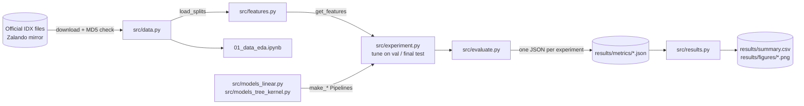

# Architecture

> Last updated: 2026-10-26 — Static structure of the project. Runtime behavior (pipeline order, leakage controls) lives in system-design.md.

## 1. Overview
This is an offline machine-learning **pipeline**, not an app. It has no server, no database and no users online.
A few small Python modules in `src/` hold all the logic: data, features, models, evaluation.
One Jupyter notebook per phase calls those modules, shows plots and explains the results.
Everything the pipeline produces (metrics JSON, `summary.csv`, figures) lands in `results/`. Big intermediate files
(raw data, feature caches) live in gitignored folders and are rebuilt by code.

## 2. Component diagram


## 3. Tech stack
| Layer | Choice | Why (link decision) |
|---|---|---|
| Language | Python 3.12 | D-001 |
| Environment | conda env (Python only) + `pip install -r requirements.txt` | D-001 |
| Arrays / tables | NumPy, pandas | D-001 |
| Models / metrics | scikit-learn | D-001 |
| HOG features | scikit-image (`skimage.feature.hog`) | D-001 |
| Plots | matplotlib only (no seaborn) | D-001 |
| Notebooks | Jupyter in VS Code (local, M3 Mac); Colab as fallback | D-001 |
| Storage | `.npy` (arrays), `.json` (metrics), `.csv` (summary), `.png` (figures) | D-009 |

## 4. Codebase layout
```
fashion-image-classification-benchmark/
├── README.md                  # setup, run order, results table, team
├── AGENTS.md                  # rules for every contributor and AI tool
├── CONTRIBUTING.md            # step-by-step contributor workflow
├── CLAUDE.md                  # project instructions for Claude Code (includes AGENTS.md)
├── idea.md                    # early brainstorming (not instructions; docs/ wins)
├── requirements.txt           # pinned top-level deps
├── .github/pull_request_template.md
├── src/                       # ALL reusable logic. No plotting-only code, no notebooks.
│   ├── __init__.py
│   ├── config.py              # constants: SEED, paths, class names, split sizes, HOG params, N_JOBS
│   ├── utils.py               # set_seed(), Timer, save_fig(), save_json(), display_path()
│   ├── data.py                # download + MD5 check, IDX loader, sanity checks, split, load_splits()
│   ├── features.py            # pixel + HOG extractors, get_features() with disk cache
│   ├── evaluate.py            # evaluate() → metrics dict + JSON; model size; environment info
│   ├── experiment.py          # tune_on_val(), full_train_val_score(), final_test_run() (the only code that
│   │                          #   reads test features), cross_validate_best()
│   ├── models_linear.py       # make_dummy(), make_logreg(), make_knn() → sklearn Pipelines
│   ├── models_tree_kernel.py  # make_rf(), make_linear_svm(), make_rbf_svm() → sklearn Pipelines
│   └── results.py             # summary.csv, best-model choice, comparison + error-analysis plots (saved predictions)
├── notebooks/                 # thin: import from src, run steps, show plots, write explanations
│   ├── 01_data_eda.ipynb
│   ├── 02_features.ipynb
│   ├── 03_linear_knn.ipynb
│   ├── 04_rf_svm.ipynb
│   └── 05_results_analysis.ipynb
├── data/
│   ├── raw/                   # downloaded .gz IDX files            (gitignored)
│   └── splits/val_indices.npy # the fixed 6k validation indices     (COMMITTED)
├── features/                  # cached feature matrices             (gitignored)
├── results/                   # COMMITTED: what the professor reads
│   ├── metrics/               # per experiment: _val.json (tuning), _test.json; plus rbf_svm_*_val_full.json, rbf_svm_hog_cv.json
│   ├── figures/               # every PNG used in the report/slides
│   ├── test_log.csv           # audit log: one row each time the test set is evaluated
│   ├── hog_sweep.csv          # HOG config sweep (val accuracy per config)
│   └── summary.csv
└── docs/                      # project docs (this folder)
```
Rules for folders:
- `src/` has no notebook-only code and no hard-coded paths outside `config.py`.
- `notebooks/` holds no model or feature logic beyond a few glue lines. If code is reused, it moves to `src/`.
- `results/` is written only by code, never by hand. The one exception: **adding** annotation fields to a result JSON
  (never changing or removing values), with a `decisions.md` entry (e.g. `timing_comparable`, D-024/D-025).

## 5. Modules and responsibilities
| Module | Owns | Depends on | Must not |
|---|---|---|---|
| `config.py` | Every constant and path | — | Import other `src` modules |
| `utils.py` | Seeding, timing, saving figures | `config` | Contain ML logic |
| `data.py` | Getting raw data, verifying it, the split | `config`, `utils` | Fit any model or scaler |
| `features.py` | Turning images into feature vectors, caching them | `config`, `data` | Fit anything on val/test (HOG has nothing to fit) |
| `models_*.py` | Building unfitted sklearn `Pipeline`s from hyperparameters | `config` | Load data or train |
| `experiment.py` | Tuning on train→val; refit on 60k; the single test evaluation | `features`, `evaluate`, `models_*` | Use test data inside `tune_on_val()` |
| `evaluate.py` | Metrics, timing, model size, writing JSON | `config`, `utils` | Choose hyperparameters |
| `results.py` | Reading JSONs, building `summary.csv`, picking the best model by val, plots and error analysis | `config`, `utils`, `data` (test labels/images for error analysis) | Retrain models or predict on test |

## 6. Layering rules
`notebooks → experiment → (features, models_*, evaluate) → data → config/utils`.
Lower layers never import higher ones. Notebooks may call any `src` function.
Only `experiment.final_test_run()` predicts on test data. The other readers never influence a choice: the `data.py` sanity
checks, and phase 05's error analysis in `results.py`, which reads the saved `y_pred` plus the true test labels/images (D-011, D-032).

## 7. External services
| Service | Used for | Failure impact |
|---|---|---|
| Fashion-MNIST official mirror (Zalando, linked from github.com/zalandoresearch/fashion-mnist) | One-time download of 4 `.gz` files | Can't start a fresh clone. Already-downloaded files keep working. |

## 8. Auth and authorization
Not applicable: offline pipeline, public data.

## 9. Error handling and logging conventions
- Fail fast with a clear message: a checksum mismatch, wrong array shape, missing cache or unknown feature kind raises
  `ValueError`/`RuntimeError` naming what is wrong and how to fix it (e.g. "run data step first").
- No silent `try/except`. A broken step must stop the notebook.
- Progress messages use plain `print()` (it shows in the notebooks). No logging framework.

## 10. Configuration
There are no environment variables or secrets. All settings are constants in `src/config.py` (D-007):
| Constant | Purpose | Example |
|---|---|---|
| `SEED` | Seed for split, models, subsampling | `42` |
| `VAL_SIZE` | Validation size taken from the 60k train set | `6000` |
| `SVM_TUNE_SUBSET` | Train subset size for RBF-SVM tuning | `10000` |
| `HOG_PARAMS` | Final HOG config, chosen by the phase 02 sweep (D-017) | `{"orientations": 12, "pixels_per_cell": (4, 4), "cells_per_block": (2, 2)}` |
| `TEST_LOG_PATH`, `HOG_SWEEP_PATH` | Where the test audit log and HOG sweep table live | `results/test_log.csv`, `results/hog_sweep.csv` |
| `N_JOBS` | Parallel workers, capped for 8 GB RAM | `4` |
| `CLASS_NAMES` | 10 label names | `["T-shirt/top", …, "Ankle boot"]` |
| Paths | `DATA_RAW`, `SPLITS_DIR`, `FEATURES_DIR`, `RESULTS_DIR`, `METRICS_DIR`, `FIGURES_DIR`, … | `ROOT / "data" / "raw"` |
