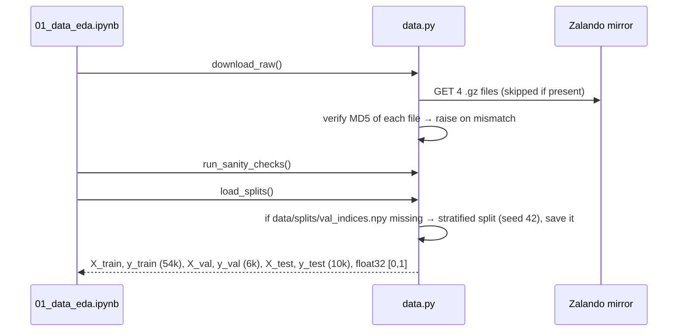
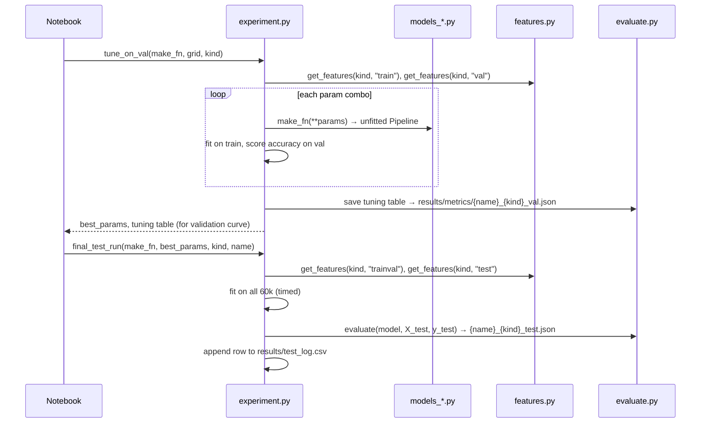

# System Design

> Last updated: 2026-10-26 — How the pipeline behaves when it runs: order of steps, how leakage is prevented, what can fail. Structure lives in architecture.md.

## 1. Requirements that drive the design
| Requirement | Target | Why it matters |
|---|---|---|
| Reproducibility | Same split and same metrics on any machine | Teammates and the examiner must get identical numbers |
| No leakage | Test set never influences any choice | The most common reason ML coursework loses marks |
| Runtime | The full pipeline finishes in a few hours on an M3 with 8 GB | It has to be practical to re-run before submission |
| Memory | Peak RAM below ~5 GB | 8 GB laptop, with VS Code and a browser also open |
| Fair comparison | Every model measured with the same `evaluate()` | Results tables are only meaningful if the measurements match |

## 2. Key flows

### Flow A: Data step (phase 01, run once)

Notes:
- `val_indices.npy` is committed, so everyone uses the exact same split even if sklearn's splitting code changes in a future version.
- EDA (PCA, t-SNE, mean images) runs on the **train split only**. Val and test stay unseen.

### Flow B: Features (phase 02)
`get_features(kind, split)` returns the cached `.npy` if it exists, otherwise builds it, saves it and returns it.
- `pixels`: flatten to 784-d. **No scaling here.** Scaling happens inside each model's Pipeline (see §3).
- `hog`: `skimage.feature.hog` per image with `config.HOG_PARAMS`. The cache filename includes the params
  (e.g. `hog_o9_p4_c2_train.npy`), so changing params can never silently reuse old features.
- `split` ∈ {`train`, `val`, `trainval`, `test`}. `trainval` = all 60k, used only for the final refit.
- HOG sweep: for each config, a proxy linear SVM (`SGDClassifier`, hinge loss, D-016) is fit on the train features and scored on val. Only val is used.

### Flow C: One experiment (phases 03–04)

Notes:
- RBF SVM: `tune_on_val` gets a stratified 10k subset of train (seed 42). The val set is still the same 6k.
- If `final_test_run` is called again for the same experiment, it still runs, but `test_log.csv` shows the repeat. That makes test-set reuse visible instead of hidden.

### Flow D: Results (phase 05)
`results.py` reads every `*_test.json` and builds `summary.csv` and the comparison plots.
The "best model" for error analysis and 5-fold CV is chosen by **val accuracy, not test accuracy**. All val scores must come
from models trained on the full 54k train split: for subset-tuned RBF SVM that's `_val_full.json`, written by
`experiment.full_train_val_score()` (D-029). Result: `rbf_svm_hog` (val 0.9157).
Error analysis reads the saved `confusion_matrix` / `y_pred` of each test JSON plus the true test labels/images from
`load_splits()`; nothing is predicted again (D-011, D-032). 5-fold CV of the best model runs on a 10k stratified subset of `trainval`.

## 3. Leakage controls (the core of this design)
| Possible loophole | How we close it |
|---|---|
| Scaler fit on val/test | `StandardScaler` lives inside the sklearn `Pipeline`, so `fit()` only ever sees training rows |
| Hyperparameters picked on test | `tune_on_val()` only loads `train` and `val`, and the test arrays are never passed in |
| HOG params picked on test | The sweep scores on val only |
| "Best model" picked on test | Selection uses val accuracy, recorded in the `_val.json` files (`_val_full.json` for subset-tuned RBF SVM, D-029) |
| EDA insights drawn from test | EDA runs on the train split only |
| Different splits per person | Committed `val_indices.npy`, plus its checksum printed and documented |
| Stale features after a param change | HOG params are encoded in the cache filename |
| Peeking at test repeatedly | Each experiment has one `final_test_run`, and every call is logged to `test_log.csv` |
| CV folds leaking scaling | CV runs `cross_val_score` on the whole Pipeline, so the scaler is refit per fold |
| Error analysis re-using test | Phase 05 reads saved predictions only; no model predicts on test again (D-011, D-032) |
| Duplicate images across train/val/test | Counted and reported in the sanity checks. Not removed, so results stay comparable to published benchmarks (D-004) |

## 4. Concurrency and race conditions
None that matter: one person runs one notebook at a time. Parallelism is limited to sklearn's
`n_jobs=config.N_JOBS` (4) inside RF and kNN. CV runs its folds one after another (`n_jobs=1`, D-018).

## 5. Async work and realtime
Not applicable.

## 6. Caching
| What | Where | Invalidation |
|---|---|---|
| Raw `.gz` files | `data/raw/` | Re-downloaded if missing or the MD5 check fails |
| Feature matrices | `features/{kind}_{params}_{split}.npy` | Filename changes when params change. Delete the folder to force a rebuild. |
| Split | `data/splits/val_indices.npy` | Never. It is fixed for the whole project. |

## 7. Failure modes
| Failure | Detection | Behavior / recovery |
|---|---|---|
| Download fails / no internet | urllib error | Stop with a message naming the URL. Retry later or copy the files in manually. |
| Corrupted / wrong file | MD5 mismatch | Delete the file and stop with an error. The next run re-downloads it. |
| Feature cache missing | File not found | Built automatically. |
| Out of memory (SVM/kNN) | Kernel crash | Lower `N_JOBS`, use `SVM_TUNE_SUBSET`, and close other apps. Documented in the README. |
| RBF SVM too slow | Wall-clock time | Tune on the 10k subset. The final 60k fit is run once: 196 s (pixels) and 451 s (HOG) on an M3 Pro. |
| Model doesn't converge (LR) | sklearn `ConvergenceWarning` | Raise `max_iter`. The warning is left visible, not suppressed. |

## 8. Security
- Downloads go to a fixed HTTPS-hosted URL in `config.py` and are verified by checksum before any parsing.
- No pickles are loaded from outside the project. Models are pickled only to measure size, never loaded back from untrusted sources.
- No secrets exist in this project.

## 9. Scaling plan
Not a concern for 70k images. The slowest steps are the RBF-SVM fit (O(n²)) and kNN prediction (brute force).
If they get too slow, the mitigation is the documented subset, or PCA-reduced pixels (parked idea).

## 10. Observability
- `Timer` prints the duration of every fit and prediction.
- Each metrics JSON records Python and sklearn versions, CPU model, `n_jobs` and a timestamp, so the timing numbers can be interpreted later.
- `results/test_log.csv` is the audit trail for test-set use.

## 11. Trade-offs accepted
| Trade-off | Why acceptable now | Revisit when |
|---|---|---|
| Single holdout val (6k) instead of k-fold for tuning | 6k is large enough for stable estimates, and it's simple and fast. k-fold is used once on the best model to show stability. | Val scores of two configs are within ~0.3% of each other |
| RBF SVM tuned on 10k, not 54k | Full-size tuning would take hours on a laptop | Never for v1. It's documented in the report. |
| Timing measured on laptops with `n_jobs=4` | Phase 03 ran on an Apple M3 and phase 04 on an M3 Pro; gaps of 10× or more are still clear, small gaps are approximate (D-028) | A single-machine re-timing, or Phase 2 GPU timings (report them separately) |
| Duplicates kept | Matches the official benchmark protocol | Sanity checks find a large number of duplicates |

## 12. v2 additions (Capstone Phase 2: CNN)

### Flow E: Train, choose and test a CNN (notebook 06)
1. `make_loaders()` calls `load_splits()`, keeps train (54k, shuffled with a seeded generator) and val (6k), drops test.
2. `train_cnn("cnn2", CNN2)`: seed, build the model and fresh loaders; per epoch, train on all batches, then score val with dropout off; keep the
   weights with the lowest val loss; stop after 5 epochs without improvement; restore the best weights; write
   `models/cnn2_images_best.pt`, `results/training/cnn2_images_history.csv`, `results/metrics/cnn2_images_val.json`.
3. Same for CNN3. Compare val accuracies; record the final CNN (D-035).
4. `final_test_run_cnn("cnn2")` and `("cnn3")`: load the checkpoint, wrap in `CNNPredictor`, call `evaluate()` once on
   the 10k test images, append to `test_log.csv`.
5. Notebook 07 reads only saved JSONs/CSVs (+ true test labels/images for the image grids), as Phase 1's notebook 05 does.

### Leakage controls added in v2
| Possible loophole | How we close it |
|---|---|
| Test images used in training or early stopping | `make_loaders()` has no test loader; only `final_test_run_cnn()` reads `X_test` |
| CNN2 vs CNN3 picked on test | Choice by val accuracy, recorded before the test runs (D-035) |
| Val data used for weight updates | Val is only scored, under `torch.no_grad()`; no refit on train + val |
| Dropout left on when scoring | `CNNPredictor` and the val step call `model.eval()` |
| Normalization statistics from val/test | None are computed: pixels are already in [0, 1] from `load_splits()` |
| Test repeated on notebook re-run | Notebook 06 skips a test run whose test JSON exists; every run is logged in `test_log.csv` |
| Phase 1 outputs changed by v2 | `results.py` defaults to Phase 1 models; v2 writes `summary_all.csv`; tagged figure names (D-037) |

### Failure modes added in v2
| Failure | Detection | Behavior / recovery |
|---|---|---|
| Out of memory when predicting 10k images | Kernel crash | `CNNPredictor` predicts 1,000 images at a time (`CNN_PREDICT_BATCH`) |
| Checkpoint missing at test time (fresh clone) | `RuntimeError` from `final_test_run_cnn` | Message says to delete the val JSON and re-run the training cell |
| Training diverges or stalls | Val accuracy outside the PRD §10.5 range; best epoch 1 or 30 | Check learning rate, `model.eval()`, reshape; the history CSV shows every epoch |
| Different numbers on re-run | Val accuracy differs from the committed JSON | CPU only, seeded, deterministic algorithms, `num_workers=0` (D-036) |
| Slow training on the laptop | Epoch time in the history CSV | Expected a few minutes per model on an M3 CPU; Colab CPU as fallback (record the device) |

Trade-off accepted: CNNs learn from 54k images while Phase 1 models were refit on 60k (D-035); this can only favour Phase 1.

### Flow F: Hybrid CNN features + RBF SVM (notebook 08, D-044)
1. `features.get_features("cnn", split)` loads CNN3's checkpoint (`cnn.load_trained`) and caches its 128 last-hidden-layer
   activations per image. CNN3 is frozen: its weights came from the 54k train split only.
2. Phase 1 RBF SVM protocol, unchanged: `tune_on_val` (10k subset, `RBF_SVM_GRID`), `full_train_val_score` (54k),
   `final_test_run` (60k refit, one test evaluation, logged).
3. Leakage: extracting features fits nothing; test features are only read inside `final_test_run`. The `features`
   filter in `results.py` keeps the hybrid (model `rbf_svm`) out of Phase 1's `summary.csv` and best-model pick.
